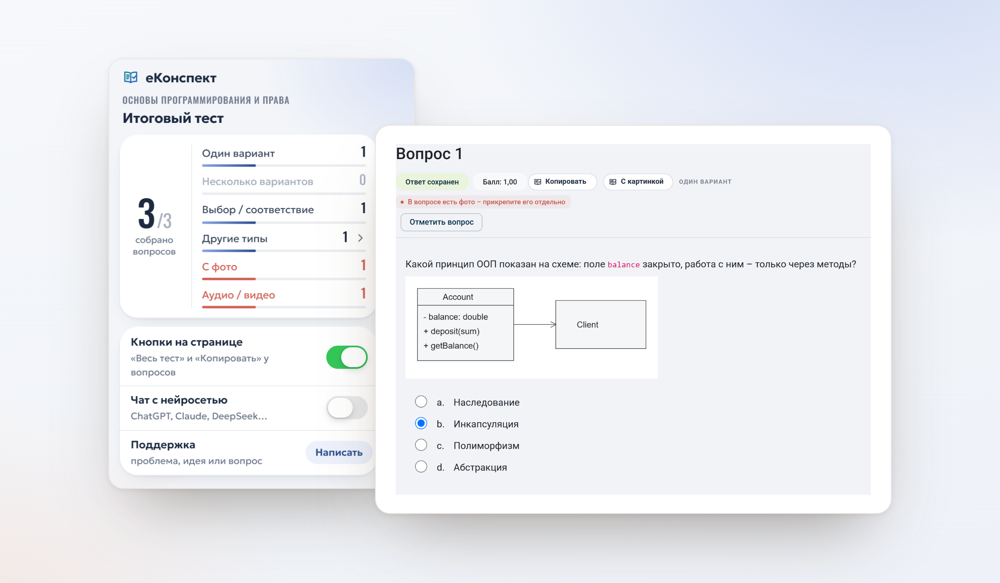
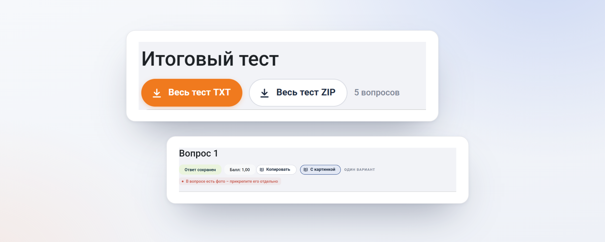
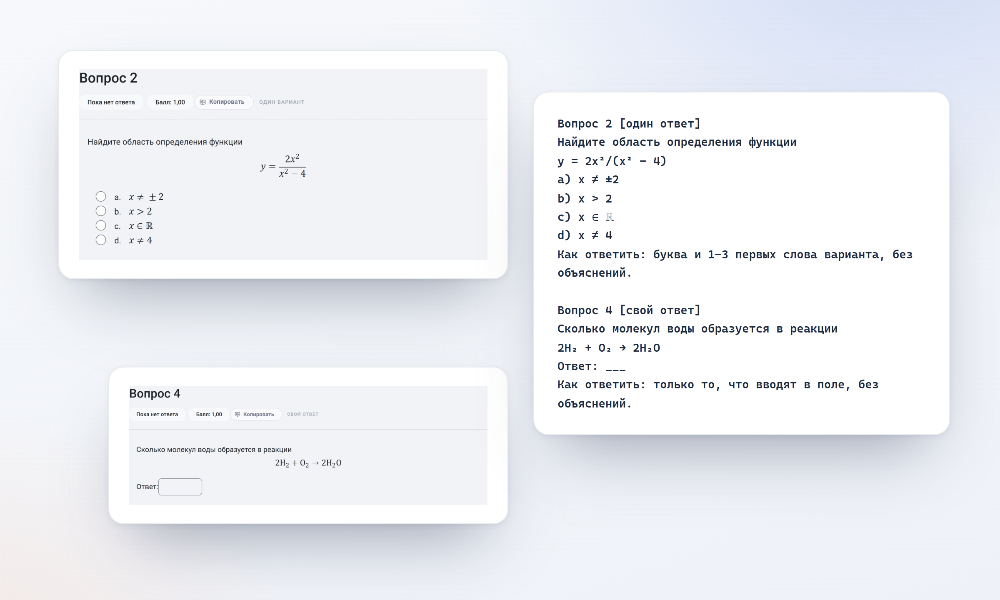
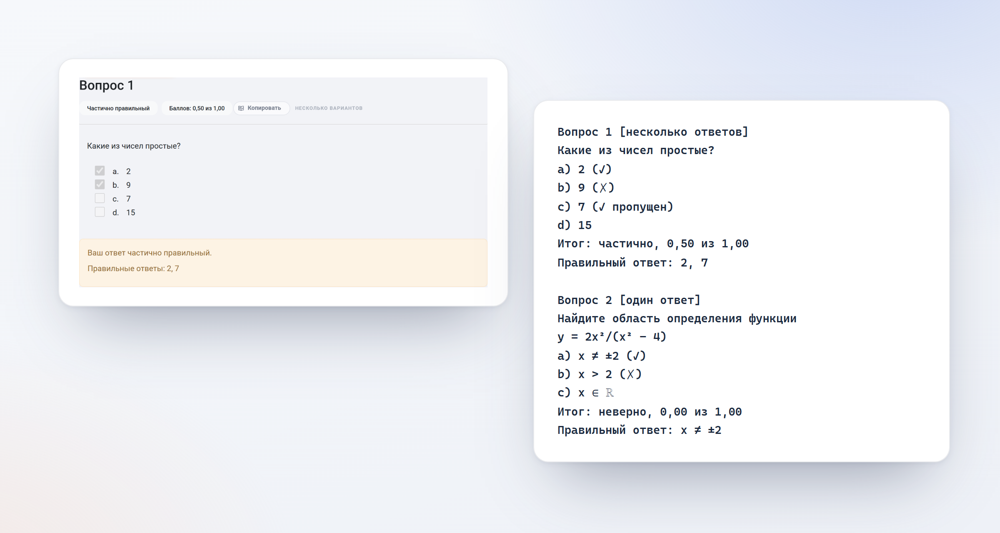
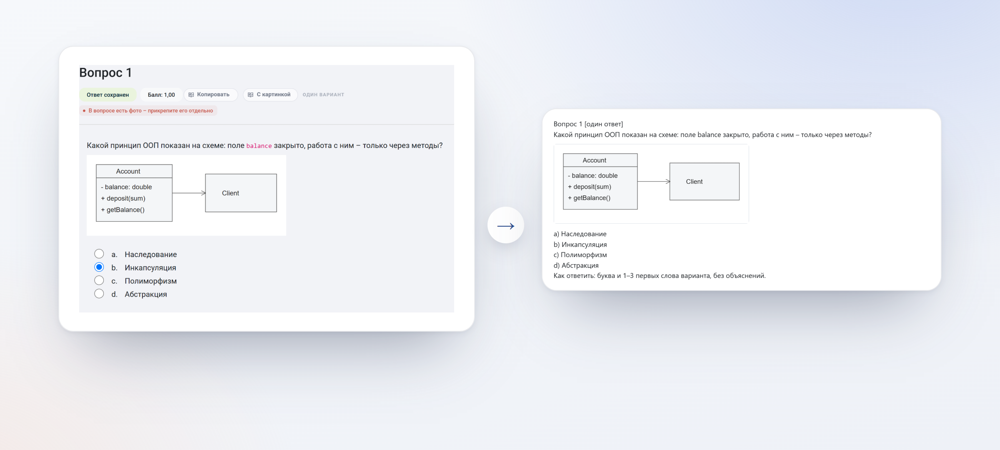
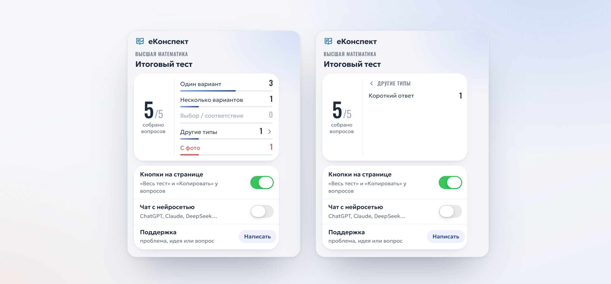
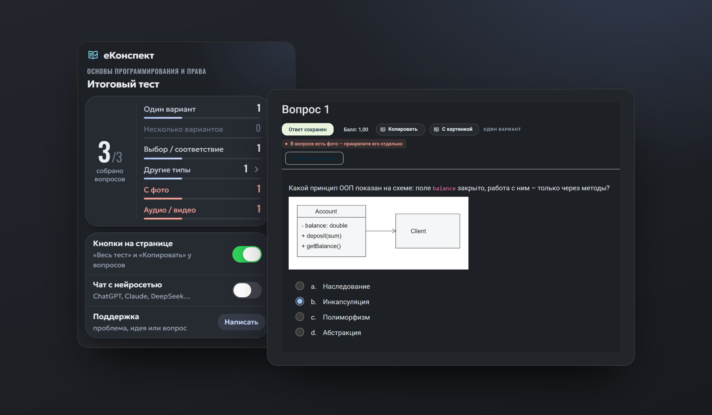

# еКонспект

### Весь тест — в одном файле.

Расширение для браузера, которое превращает тест или лекцию электронного курса на Moodle в чистый, структурированный текст. Одним нажатием.

**[Установить для Chrome](https://chromewebstore.google.com/detail/dmknldkgldhkpgmpdjfnipeecbmlinpb)**&nbsp;&nbsp;·&nbsp;&nbsp;**[Установить для Firefox](https://addons.mozilla.org/ru/firefox/addon/ekonspekt/)**&nbsp;&nbsp;·&nbsp;&nbsp;[Конфиденциальность](PRIVACY.md)

 

 

## Подготовка начинается с материала

Чтобы готовиться к экзамену, нужны сами вопросы. На сайте они разбросаны по десяткам страниц, а после теста просмотр часто закрыт. Копировать их по одному — это потерянные часы.

еКонспект делает эту работу за вас. Откройте тест — расширение соберёт все страницы само, в фоне, и выдаст один аккуратный файл: вопросы, варианты, пропуски и ваши результаты — в том порядке, в каком их видите вы.

 

## Всё нужное — прямо на странице

Главные действия вынесены туда, где они нужны. У названия теста — «Весь тест TXT», «Весь тест ZIP» и «Копировать весь тест», рядом — сколько вопросов уже собрано. У каждого вопроса — «Копировать» и, если в нём есть рисунок, «С картинкой». Открывать окно расширения не нужно.

 

## Формулы, которые можно читать

Дроби, степени, пределы, множества, логика и химические уравнения превращаются в обычный текст — без кода разметки и пустых квадратов. Такой текст понятен человеку, документу и нейросети.

 
Слева — вопрос на сайте. Справа — он же в файле.

 

## Ваши результаты — рядом с ответами

В просмотре попытки еКонспект отмечает ваши ответы: `✓` — верно, `✗` — неверно, `✓ пропущен` — верный вариант, который вы не выбрали. Итог, баллы и правильный ответ, если его открыл преподаватель, — сразу под вопросом. Если правильные ответы скрыты, расширение по баллам подскажет, где искать верный.

 

## Схемы и рисунки — одной картинкой

Кнопка «С картинкой» собирает вопрос, варианты и рисунок в одно изображение. Его можно вставить в чат с нейросетью, в документ или конспект. Архив «Весь тест ZIP» содержит текст и снимки всех вопросов с изображениями.

 

## Состав теста — с первого взгляда

Окно расширения показывает, сколько вопросов собрано и каких они типов. Отдельно отмечены вопросы с фото, аудио и видео — то, что нельзя передать текстом и стоит посмотреть на странице.

 

## И ещё

**Вопросы сохраняются, даже когда сайт их скрыл.** Пока вы проходите тест, еКонспект сохраняет вопросы у вас в браузере. Если после попытки просмотр закрыт, файл всё равно будет.

**Лекции тоже.** «Вся лекция TXT / ZIP» — конспект с рисунками, собранный со всех страниц лекции.

**Готово для нейросети.** Короткий и однозначный формат с подсказкой, как отвечать. Пометка «!» указывает, где для ответа нужен материал вне текста: рисунок, видео или лекция.

**Все распространённые типы вопросов.** Один и несколько ответов, соответствие, пропуски, выбор слов, короткий и числовой ответ, эссе, упорядочивание, задания на изображении.

 

## Почему еКонспект

|  | еКонспект | Вручную | Печать страницы в PDF |
|---|:---:|:---:|:---:|
| Все страницы теста сразу | ✓ | — | — |
| Вопросы после закрытия просмотра | ✓ | — | — |
| Читаемые формулы и химия | ✓ | частично | — |
| Ваши ✓ и ✗ рядом с ответами | ✓ | — | частично |
| Текст, готовый для нейросети | ✓ | ✓ | — |
| Тест из 50 вопросов | секунды | около часа | минуты |

 

## Приватность — без оговорок

Мы считаем, что инструмент для учёбы не должен знать о вас ничего лишнего.

- **Нет серверов.** Данные не уходят ни нам, ни кому-либо ещё.
- **Нет аналитики и рекламы.**
- **Минимум разрешений:** один сайт и хранилище браузера.
- **Только чтение.** Расширение не отправляет ответы, не нажимает кнопки и не действует от вашего имени.
- **Всё хранится у вас** и удаляется вместе с расширением.

Подробно — в [политике конфиденциальности](PRIVACY.md).

 

 
Светлая и тёмная тема — как у браузера и сайта.

 

## Качество

Каждая версия проходит более 300 автоматических проверок на разметке всех поддерживаемых типов вопросов, браузерные тесты и проверку пакета перед отправкой в магазин. Разбор теста из 120 вопросов в файл занимает около десятой доли секунды.

 

## Установка

| Браузер | |
|---|---|
| Firefox | [addons.mozilla.org](https://addons.mozilla.org/ru/firefox/addon/ekonspekt/) |
| Chrome, Яндекс.Браузер, Edge, Opera | [Chrome Web Store](https://chromewebstore.google.com/detail/dmknldkgldhkpgmpdjfnipeecbmlinpb) |

После установки обновите страницу теста. Кнопки появятся у названия.

 

## О проекте

еКонспект создаёт небольшая независимая команда. Мы делаем инструмент, которым пользуемся сами, и относимся к нему как к продукту: без компромиссов в качестве и в отношении к вашим данным.

Предложения и сообщения об ошибках — в разделе [Поддержка](SUPPORT.md).

 

---

<b>English</b>

 

**eKonspekt** is a browser extension that turns a Moodle quiz or lesson into one clean, structured text file — in a single click.

- Collects every page of a quiz automatically, in the background.
- One-click buttons right on the page: next to the quiz title and next to every question.
- Renders formulas, sets, logic and chemistry as readable text.
- Shows your ✓ and ✗ next to answers in the attempt review.
- Copies a question with its diagram as a single image; exports images as a ZIP.
- Keeps questions available even after the review is closed.
- No servers, no analytics, no ads. Everything stays in your browser.

Available in the [Chrome Web Store](https://chromewebstore.google.com/detail/dmknldkgldhkpgmpdjfnipeecbmlinpb) and for [Firefox](https://addons.mozilla.org/ru/firefox/addon/ekonspekt/). The interface is in Russian.

еКонспект — независимый проект. Он не связан с владельцами сайта электронных курсов и с Moodle Pty Ltd и не одобрен ими. Исходный код в этом репозитории не публикуется.
