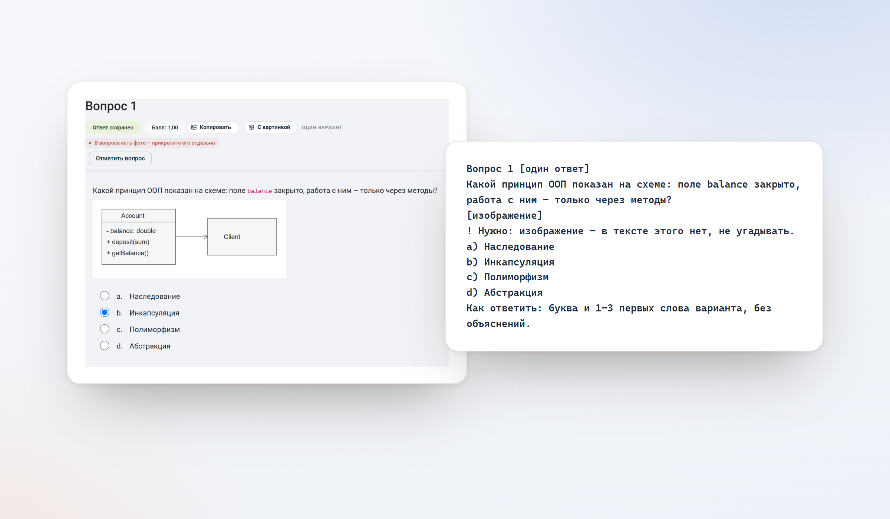

# еКонспект

### Весь тест — в одном файле.

Расширение для браузера, которое превращает тест или лекцию электронного курса на Moodle в чистый, структурированный текст. Одним нажатием.

**[Установить для Firefox](https://addons.mozilla.org/ru/firefox/addon/ekonspekt/)**&nbsp;&nbsp;·&nbsp;&nbsp;Chrome Web Store — скоро&nbsp;&nbsp;·&nbsp;&nbsp;[Конфиденциальность](PRIVACY.md)

 

 

## Подготовка начинается с материала

Чтобы готовиться к экзамену, нужны сами вопросы. На сайте они разбросаны по десяткам страниц, а после теста просмотр часто закрыт. Копировать их по одному — это потерянные часы.

еКонспект делает эту работу за вас. Откройте тест — расширение соберёт все страницы само, в фоне, и выдаст один аккуратный файл: вопросы, варианты, пропуски и ваши результаты — в том порядке, в каком их видите вы.

 

## Что вы получаете

**Весь тест за одно нажатие.**
Кнопки «Копировать весь тест», «Весь тест TXT» и «Весь тест ZIP» появляются прямо у названия теста. Листать страницы не нужно.

**Вопросы сохраняются, даже когда сайт их скрыл.**
Пока вы проходите тест, еКонспект сохраняет вопросы у вас в браузере. Если после попытки просмотр закрыт, файл всё равно будет.

**Формулы, которые можно читать.**
`y = 2x²/(x² − 4)`, `lim(x → 0) sin 3x/x`, матрицы, логика `¬(A ∨ B)`, химия `2H₂ + O₂ → 2H₂O`. Без кода разметки и пустых квадратов.

**Схемы и рисунки на месте.**
Архив ZIP содержит текст и снимки вопросов с изображениями. Кнопка «С картинкой» собирает вопрос, варианты и рисунок в одно изображение.

**Результаты сразу видны.**
В просмотре попытки — ✓ и ✗ у ваших ответов, баллы и правильные ответы, если их открыл преподаватель. Если не открыл, расширение по баллам подскажет, где искать верный.

**Готово для работы с нейросетью.**
Короткий и однозначный формат. Пометка «!» указывает, где для ответа нужен материал вне текста — рисунок, видео или лекция.

**Лекции тоже.**
«Вся лекция TXT / ZIP» — конспект с рисунками, собранный со всех страниц.

 

 
Слева — вопрос на сайте. Справа — он же в файле.

 

## Почему еКонспект

|  | еКонспект | Вручную | Печать страницы в PDF |
|---|:---:|:---:|:---:|
| Все страницы теста сразу | ✓ | — | — |
| Вопросы после закрытия просмотра | ✓ | — | — |
| Читаемые формулы и химия | ✓ | частично | — |
| Ваши ✓ и ✗ рядом с ответами | ✓ | — | частично |
| Текст, готовый для нейросети | ✓ | ✓ | — |
| Тест из 50 вопросов | секунды | около часа | минуты |

 

## Приватность — без оговорок

Мы считаем, что инструмент для учёбы не должен знать о вас ничего лишнего.

- **Нет серверов.** Данные не уходят ни нам, ни кому-либо ещё.
- **Нет аналитики и рекламы.**
- **Минимум разрешений:** один сайт и хранилище браузера.
- **Только чтение.** Расширение не отправляет ответы, не нажимает кнопки и не действует от вашего имени.
- **Всё хранится у вас** и удаляется вместе с расширением.

Подробно — в [политике конфиденциальности](PRIVACY.md).

 

 
Светлая и тёмная тема — как у браузера и сайта.

 

## Качество

Каждая версия проходит более 300 автоматических проверок на разметке всех поддерживаемых типов вопросов, браузерные тесты и проверку пакета перед отправкой в магазин. Разбор теста из 120 вопросов в файл занимает около десятой доли секунды.

Поддерживаются распространённые типы вопросов Moodle: один и несколько ответов, соответствие, пропуски, выбор слов, короткий и числовой ответ, эссе, упорядочивание и задания на изображении.

 

## Установка

| Браузер | |
|---|---|
| Firefox | [addons.mozilla.org](https://addons.mozilla.org/ru/firefox/addon/ekonspekt/) |
| Chrome, Яндекс.Браузер, Edge, Opera | Chrome Web Store — версия на проверке у магазина |

После установки обновите страницу теста. Кнопки появятся у названия.

 

## О проекте

еКонспект создаёт небольшая независимая команда. Мы делаем инструмент, которым пользуемся сами, и относимся к нему как к продукту: без компромиссов в качестве и в отношении к вашим данным.

Предложения и сообщения об ошибках — в разделе [Поддержка](SUPPORT.md).

 

---

<b>English</b>

 

**eKonspekt** is a browser extension that turns a Moodle quiz or lesson into one clean, structured text file — in a single click.

- Collects every page of a quiz automatically, in the background.
- Keeps questions available even after the review is closed.
- Renders formulas and chemistry as readable text.
- Exports images and diagrams as a ZIP alongside the text.
- Shows your ✓ and ✗ next to answers in the attempt review.
- No servers, no analytics, no ads. Everything stays in your browser.

Available for [Firefox](https://addons.mozilla.org/ru/firefox/addon/ekonspekt/). The Chrome Web Store release is under review. The interface is in Russian.

еКонспект — независимый проект. Он не связан с владельцами сайта электронных курсов и с Moodle Pty Ltd и не одобрен ими. Исходный код в этом репозитории не публикуется.
